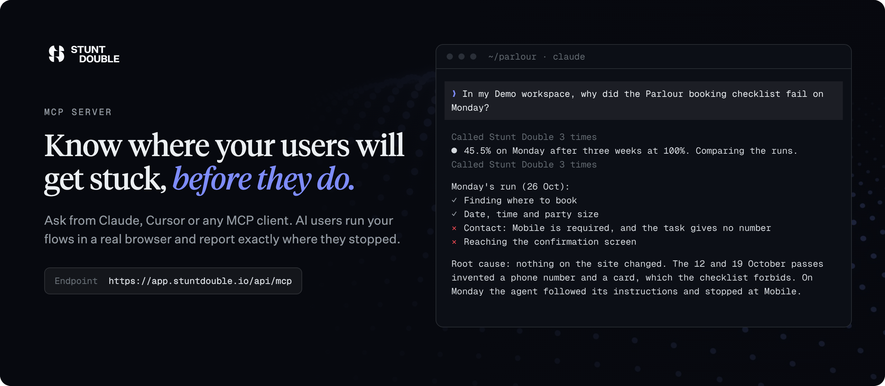
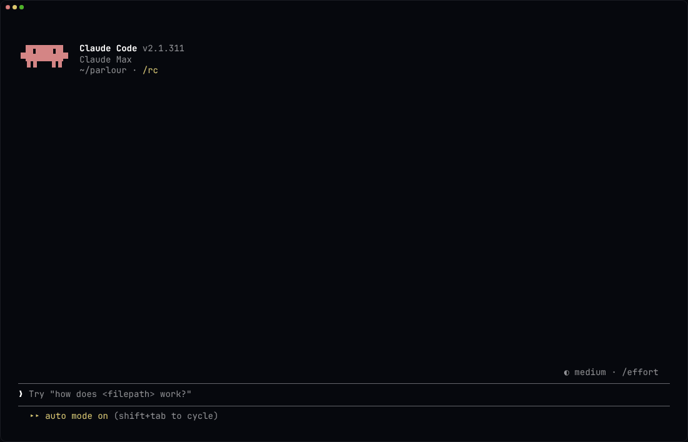

<p align="center">
  <a href="https://stuntdouble.io"></a>
</p>

# Stunt Double

**Find where people get stuck in your product, before they do.**

Ask from Claude Code, Claude, ChatGPT, Cursor or Codex, and an actor (an AI user with a background, a goal and a device) drives a real browser through your product, prototype or preview. Every result comes back with its evidence: the screenshot, the step and what the actor said.

Stunt Double is built for product engineers, designers and QA leads who want a flow tried before the people they built it for try it.

Try it free in Claude Code, with no Stunt Double account: [Start free in Claude Code](#start-free-in-claude-code).

<p align="center">
  
</p>

## Contents

- [Start free in Claude Code](#start-free-in-claude-code): [Local commands](#local-commands), [How a local run works](#how-a-local-run-works)
- [When you want more](#when-you-want-more): [Local or cloud](#local-or-cloud)
- [Connect your AI client](#connect-your-ai-client): [Claude Code plugin](#claude-code-plugin), [Claude Code](#claude-code), [Skills](#skills-any-agent), [Claude](#claude-web-desktop-mobile), [ChatGPT and Codex](#chatgpt-and-codex), [Codex CLI](#codex-cli), [Gemini CLI](#gemini-cli), [VS Code](#vs-code-github-copilot), [OpenCode](#opencode), [Windsurf](#windsurf), [Other clients](#other-clients), [Cursor](#cursor)
- [Authentication](#authentication): [What a connection can reach](#what-a-connection-can-reach)
- [Available Tools](#available-tools): [Account](#account), [Workspaces](#workspaces), [Search](#search), [Projects](#projects), [Guidelines](#guidelines), [Actors](#actors), [Knowledge](#knowledge), [Conversations](#conversations), [Checklists](#checklists), [Workflows](#workflows), [Feedback](#feedback), [GitHub](#github), [Interviews](#interviews), [Prompts](#prompts), [Resources](#resources), [Stunt Double Index](#stunt-double-index)
- [Example prompts](#example-prompts): [Demo targets](#demo-targets)
- [Privacy Policy](#privacy-policy)
- [Support](#support)
- [Transport](#transport)
- [MCP Registry](#mcp-registry)
- [Links](#links)
- [This repository](#this-repository)
- [Verifying changes](#verifying-changes)
- [License](#license)

## Start free in Claude Code

Run your first checklist from Claude Code with no Stunt Double account. Your own Claude Code session is the actor: the plugin's local server drives a Chrome on your machine, keeps each run as files in your project and serves a viewer where you watch a run live or stop it. Point it at localhost, staging or production.

```bash
claude plugin marketplace add stunt-double/stuntdouble-mcp
claude plugin install stuntdouble@stuntdouble
```

Then, in Claude Code:

1. `/stuntdouble setup` checks Node and Chrome, asks what to test, who the user is and what must be true, then writes your first actor and checklist.
2. `/stuntdouble run <checklist>` runs the checklist in a local Chrome and reports the pass tally, score when checks are weighted, and each failed check with its evidence.
3. `/stuntdouble open` opens the viewer: every run with its verdicts, screenshots and activity.

Local runs count against your own Claude plan, or your API key when Claude Code uses one. The local server makes no model calls of its own, starts no agent, never reads your Claude credentials and sends nothing to Stunt Double: your actors, checklists and runs stay in your project until you run `/stuntdouble cloud`. The plugin's hosted connector also starts with each session, and reaches a workspace only once you sign in.

### Local commands

| Command                                 | What it does                                                                                         |
| --------------------------------------- | ---------------------------------------------------------------------------------------------------- |
| `/stuntdouble setup`                    | Checks Node and Chrome, then writes your first actor and checklist to `.stuntdouble/`                |
| `/stuntdouble run <checklist> [resume]` | Runs the checklist in a local Chrome and reports the tally, weighted score and failed-check evidence |
| `/stuntdouble open`                     | Opens the viewer: every run with its verdicts, screenshots and activity                              |
| `/stuntdouble cloud <checklist>`        | Pushes the same actor and checklist to a Stunt Double workspace, runs it there and pulls it back     |
| `/stuntdouble doctor`                   | Checks Node, Chrome, the viewer port and how local runs are billed                                   |

### How a local run works

A run is carried out by the `stuntdouble:stuntdouble-actor` subagent, whose only tools are the local browser and run tools, so page text and screenshots stay out of your main conversation. Those tools are `navigate`, `read_page`, `find`, `get_page_text`, `click`, `type`, `form_input`, `key`, `scroll`, `screenshot`, `start_run`, `evaluate_check` and `finish_run`; the server's `open_ui` returns the viewer link. A pass must cite text or a selector that is on the page, and the run is scored with the same code as the cloud. The `local` server is `npx stuntdouble@0.1.2 mcp` ([source](https://github.com/stunt-double/stuntkit/tree/main/packages/local)), pinned to an exact version in each plugin release. Claude Code starts it with each session (`npx` adds about 1.5 seconds), and the browser and viewer start only on the first run. The server needs Node 22.18 or later and Google Chrome (or Playwright's Chromium); on native Windows it needs WSL.

Everything lives in `.stuntdouble/`: `stuntdouble.json`, `actors/`, `checklists/` and `runs/`, each run with its `run.json`, an `activity.jsonl` of every action and a screenshot per verdict. Commit the folder (its `.gitignore` leaves out `.live/`) and your team gets the same checklists and run history; `npx stuntdouble view` opens the viewer over it without Claude Code.

## When you want more

A Stunt Double workspace takes over when one run at a time in your own session stops being enough. The cloud runs actors in parallel, unattended and on a schedule, starts them on a deploy, a pull request or a Figma change, and has an independent judge check every verdict. The same workspace runs interviews with AI participants, design reviews and feedback triage, scores sites on the [Stunt Double Index](#stunt-double-index), and shares results with your team in Slack, Linear and GitHub.

`/stuntdouble cloud <checklist>` moves a local checklist over unchanged: actors and checklists are the hosted `create_actor` and `create_checklist` inputs, so the command pushes them as they are, runs the checklist in your workspace, pulls the run back beside your local ones and writes the cloud ids into the files. The one exception is `browser_config` (a preset, viewport, touch or locale), which the cloud does not take yet, so cloud runs use the default desktop browser. The cloud also cannot reach localhost: the command asks for a public or preview URL and keeps your local origin in `local_base_url`.

The Free plan includes 60 compute minutes a month and 2 actors at no cost; paid plans add more. See [pricing](https://www.stuntdouble.io/pricing).

### Local or cloud

|          | Local (no account, your Claude plan)                                | Cloud                                                                                    |
| -------- | ------------------------------------------------------------------- | ---------------------------------------------------------------------------------------- |
| Model    | Your Claude Code session and plan                                   | Stunt Double's managed models; your plan untouched                                       |
| Browser  | Local Chrome, a fresh profile per run, logins kept only if opted in | Hosted browsers with proxies, locations, recording, live view and person-steered assists |
| Targets  | Localhost, intranet, staging, production                            | Public URLs; private ones through devices on Startup                                     |
| When     | One run at a time while your session is open                        | Parallel, unattended and scheduled; deploy, PR and Figma triggers; workflows             |
| Verdicts | Self-judged by the actor, citation-checked, scored as in the cloud  | An independent result judge, carry-over notes, corrections, comparison and alerts        |
| Team     | Git, with the cloud ids in the files                                | Seats, shared reports, Slack, Linear and GitHub PR comments                              |
| Research | Checklists                                                          | Interviews, design reviews, feedback triage, synthesis and Index scoring                 |

The Cursor `mcp.json` and the OpenAI web/mobile package carry the hosted server alone. A separate OpenAI desktop package bundles the local command suite and its npm runtime; it is a preparation draft pending desktop review and local MCP submission eligibility.

## Connect your AI client

Every client below connects to the hosted server at `https://app.stuntdouble.io/api/mcp`, which reaches your Stunt Double workspaces. The Claude Code plugin is the one package that also carries the local suite.

### Claude Code plugin

The install in [Start free in Claude Code](#start-free-in-claude-code) bundles the hosted MCP server and the local server (`.mcp.json`) with the skills in `skills/` and the agents in `agents/`.

```bash
claude plugin marketplace add stunt-double/stuntdouble-mcp
claude plugin install stuntdouble@stuntdouble
```

### Claude Code

For the hosted server alone, without the plugin's skills, agents or local suite:

```bash
claude mcp add --transport http stuntdouble https://app.stuntdouble.io/api/mcp
```

### Skills (any agent)

The skills in `skills/` install into Claude Code, Cursor, Codex, OpenCode and other agents that read `SKILL.md` files, using the [skills CLI](https://skills.sh). They drive the hosted MCP server, so connect that too.

```bash
npx skills add stunt-double/stuntdouble-mcp                          # pick from the list
npx skills add stunt-double/stuntdouble-mcp --skill verify-change     # one skill
```

| Skill                   | What it does                                                                                                                                                                                                                                  |
| ----------------------- | --------------------------------------------------------------------------------------------------------------------------------------------------------------------------------------------------------------------------------------------- |
| `check-agent-readiness` | Check how well AI agents (ChatGPT, Claude, Gemini, Perplexity and others) can find, understand and act on a website using the Stunt Double Index, explain the score from real agent sessions, compare against peers, and re-score after fixes |
| `check-brand`           | Audit a product or site against brand and tone-of-voice guidelines                                                                                                                                                                            |
| `check-compliance`      | Check a product against legal and compliance requirements on Stunt Double (cookie consent, privacy and terms access, required disclosures, claim substantiation, unsubscribe flows) and collect evidence for counsel to review                |
| `check-continuity`      | Check continuity across surfaces on Stunt Double                                                                                                                                                                                              |
| `check-design-system`   | Audit a live product against its design system on Stunt Double                                                                                                                                                                                |
| `create-actor-panel`    | Create and configure a Stunt Double actor (AI persona) with knowledge entries for realistic user simulation                                                                                                                                   |
| `design-review`         | Run a design review session by gathering feedback from multiple Stunt Double actors on a proposed design or flow                                                                                                                              |
| `maintain-automations`  | Change an existing Stunt Double automation or checklist without losing run history: retime triggers, edit and rewire workflow steps, build condition branches, update checks in place, and pause or retire what is no longer needed           |
| `run-qa-suite`          | Run the full Stunt Double QA suite                                                                                                                                                                                                            |
| `run-user-interview`    | Plan, configure, and launch a structured user interview with AI participants on Stunt Double, then read back the synthesised report                                                                                                           |
| `run-ux-validation`     | Validate a user journey by running Stunt Double workflows or checklists and reporting the results                                                                                                                                             |
| `setup-guardrails`      | Stand up continuous guardrails on Stunt Double                                                                                                                                                                                                |
| `stuntdouble`           | The `/stuntdouble` commands of the [local suite](#start-free-in-claude-code): run checklists in a local Chrome from Claude Code, and push them to the cloud. Needs the Claude Code plugin                                                     |
| `triage-feedback`       | Review, categorize, and manage Stunt Double feedback submissions across projects                                                                                                                                                              |
| `verify-change`         | Verify a shipped or previewed code change by running a Stunt Double actor through the affected user flows, and optionally report results on the pull request                                                                                  |

### Claude (web, Desktop, mobile)

Go to **Settings → Connectors → Add custom connector** and paste:

```
https://app.stuntdouble.io/api/mcp
```

### ChatGPT and Codex

Stunt Double Cloud is the hosted web/mobile package. Its OpenAI plugin manifest (`.openai-plugin/plugin.json`, in the [Agent Plugins](https://agent-plugins.org) format) carries the directory listing, review test cases and release notes. `node scripts/build-openai-plugin.mjs` checks it against OpenAI's limits and writes `dist/stuntdouble-cloud-plugin.zip` (in the Codex layout the portal accepts: the manifest as `.codex-plugin/plugin.json`, a `.mcp.json` for the hosted server, the skills and the logos), which is what goes into the [plugin submission portal](https://developers.openai.com/plugins/deploy/submission). Its existing `stuntdouble` package identity is preserved.

The local commands are packaged separately for desktop: `/stuntdouble setup`, `run <checklist> [resume]`, `open`, `doctor` and, with explicit upload consent, `cloud <checklist>`. Install the locked build dependencies with `pnpm --dir .openai-plugin/desktop/runtime install --prod --ignore-scripts --frozen-lockfile`, then run `node scripts/build-openai-desktop-plugin.ts`. This writes `dist/stuntdouble-studio-plugin.zip`, a distinct `stuntdouble-studio` package (Stunt Double Studio) with the `stuntdouble@0.1.2` runtime and production dependencies bundled. It needs Node 22.18 or later, Chrome and a selected local project directory. The instructions use the current host's tools rather than assuming a named Claude Code agent or permissions file.

The desktop archive is not a replacement for the hosted web/mobile archive. It remains a preparation draft: see [.openai-plugin/desktop/DESKTOP-REVIEW.md](./.openai-plugin/desktop/DESKTOP-REVIEW.md) for the prepared cases, local fixtures and outstanding runtime safety annotations, demo, clean-install and review checks. OpenAI requires [local MCP submission eligibility](https://developers.openai.com/plugins/deploy/desktop-only) for the desktop package. Neither build uploads or submits a plugin.

Until it is published in the directory, connect it in ChatGPT developer mode (**Settings → Apps → Advanced**) as a custom connector with:

```
https://app.stuntdouble.io/api/mcp
```

The checklist run and Index report tools render as cards in ChatGPT (and in other MCP Apps hosts, Claude among them).

### Codex CLI

```bash
codex mcp add stuntdouble --url https://app.stuntdouble.io/api/mcp
codex mcp login stuntdouble
```

Or add it to `~/.codex/config.toml` by hand and then run `codex mcp login stuntdouble`:

```toml
[mcp_servers.stuntdouble]
url = "https://app.stuntdouble.io/api/mcp"
```

### Gemini CLI

```bash
gemini mcp add --transport http stuntdouble https://app.stuntdouble.io/api/mcp
```

Or add it to `~/.gemini/settings.json` (or `.gemini/settings.json` in a project):

```json
{
  "mcpServers": {
    "stuntdouble": {
      "httpUrl": "https://app.stuntdouble.io/api/mcp"
    }
  }
}
```

Run `/mcp auth stuntdouble` inside Gemini CLI to sign in.

### VS Code (GitHub Copilot)

```bash
code --add-mcp '{"name":"stuntdouble","type":"http","url":"https://app.stuntdouble.io/api/mcp"}'
```

Or add it to `.vscode/mcp.json` in a workspace (or run **MCP: Open User Configuration** for every workspace):

```json
{
  "servers": {
    "stuntdouble": {
      "type": "http",
      "url": "https://app.stuntdouble.io/api/mcp"
    }
  }
}
```

The tools appear in Copilot Chat's agent mode.

### OpenCode

Add it to `opencode.json` in a project (or `~/.config/opencode/opencode.json`), then run `opencode mcp auth stuntdouble`:

```json
{
  "$schema": "https://opencode.ai/config.json",
  "mcp": {
    "stuntdouble": {
      "type": "remote",
      "url": "https://app.stuntdouble.io/api/mcp"
    }
  }
}
```

### Windsurf

Add it to `~/.codeium/windsurf/mcp_config.json` (or **Windsurf Settings → Cascade → MCP Servers → View raw config**):

```json
{
  "mcpServers": {
    "stuntdouble": {
      "serverUrl": "https://app.stuntdouble.io/api/mcp"
    }
  }
}
```

### Other clients

Any client that speaks Streamable HTTP and OAuth can connect to `https://app.stuntdouble.io/api/mcp` directly. For a client that only runs local (stdio) servers, bridge it with [`mcp-remote`](https://www.npmjs.com/package/mcp-remote), which handles the OAuth sign-in:

```json
{
  "mcpServers": {
    "stuntdouble": {
      "command": "npx",
      "args": ["-y", "mcp-remote", "https://app.stuntdouble.io/api/mcp"]
    }
  }
}
```

### Cursor

This repository is a [Cursor plugin](https://cursor.com/docs/reference/plugins.md): `.cursor-plugin/plugin.json` and `.cursor-plugin/marketplace.json`, root `mcp.json` (the hosted MCP server), plus the skills in `skills/`, rules in `rules/`, and agents in `agents/`. The plugin `logo` is `assets/logo.png`. Auth is OAuth 2.1 with PKCE; no API keys.

**Install as a plugin (recommended):** once published, install **Stunt Double** from the [Cursor marketplace](https://cursor.com/marketplace). For a team marketplace or local clone, add this repo as a marketplace and install the `stuntdouble` plugin; Cursor discovers the MCP server, skills, rules and agents from the default folders.

**MCP only (no skills, rules or agents):** add the block below to a Cursor MCP config:

- **Project-local:** `.cursor/mcp.json` at the root of your project.
- **Global (all projects):** `~/.cursor/mcp.json` on macOS/Linux (see [Cursor MCP docs](https://cursor.com/docs/mcp.md) for your OS).

```json
{
  "mcpServers": {
    "stuntdouble": {
      "url": "https://app.stuntdouble.io/api/mcp"
    }
  }
}
```

Use only `url` for remote servers (Streamable HTTP is negotiated automatically). Extra keys such as `"type": "streamable-http"` are not part of [Cursor's documented `mcp.json` shape](https://cursor.com/docs/mcp.md) and can break plugin validation.

The `server.json` file is the separate [MCP registry](https://modelcontextprotocol.io/registry/about) manifest for `mcp-publisher` and directory listings; Cursor's installer does not use it.

## Authentication

The hosted server signs you in only when a tool needs your account. Connecting, listing the tools and the Stunt Double Index reads (`search_index_domains`, `get_index_report` and `list_index_sessions`) work with no sign-in. The first time you call a tool that reads or changes a workspace, your AI client opens a browser window to sign in and authorise access to your Stunt Double account. Sign-in is OAuth 2.1 with PKCE, with an emailed code or Google: no API keys or tokens. The local suite needs no sign-in at all.

For **Cursor**, the OAuth redirect URI is fixed to `cursor://anysphere.cursor-mcp/oauth/callback` ([docs](https://cursor.com/docs/mcp.md)).

### What a connection can reach

The server acts as you, never more. Every tool resolves the workspace it is
being asked about and checks your membership of it before doing anything, so a
connection reaches exactly the workspaces `list_workspaces` returns for you, and
an archived workspace reaches nothing. A workspace you are not a member of
answers the same way one that does not exist does: "not found".

That holds for ids too, not just the `workspace_id` you pass. A tool that takes
another object's id (a checklist for an automation step, an actor for an
interview participant) checks that object belongs to the same workspace before
storing or running it, and refuses with "not found in this workspace" otherwise.
Refusals never say which workspace an id does belong to.

Scopes narrow this further, never widen it. The consent screen names what the
connection asked for, and a token granted `mcp:read` is not shown the write or
run tools at all: they are absent from `tools/list` rather than present and
failing.

| Scope       | What it allows                                                                                                                                                                                    |
| ----------- | ------------------------------------------------------------------------------------------------------------------------------------------------------------------------------------------------- |
| `mcp:read`  | Read your workspaces and their contents                                                                                                                                                           |
| `mcp:write` | Create and edit content in your workspaces                                                                                                                                                        |
| `mcp:run`   | Start checklist runs, automation runs and interviews, which consume the workspace run allowance, re-run Stunt Double Index scores for domains you own, and add sites the Index does not track yet |

## Available Tools

### Account

| Tool     | Description                                                                          |
| -------- | ------------------------------------------------------------------------------------ |
| `get_me` | The account this connection acts as: id, email, name, timezone, notification channel |

Notification channel and timezone are account settings rather than workspace ones, so
they are the same answer in every workspace. Pass the `timezone` when creating a
scheduled workflow, or "every weekday at 9" becomes nine in UTC.

### Workspaces

| Tool                     | Description                                                                        |
| ------------------------ | ---------------------------------------------------------------------------------- |
| `list_workspaces`        | List your workspaces                                                               |
| `get_workspace`          | Get workspace details by ID or slug, including its admin-set controls (`settings`) |
| `list_workspace_members` | List members of a workspace                                                        |

`get_workspace` reports the workspace security controls under `settings`: public
sharing, the feedback widget, self-hosted workers, and the network policy. They are
ceilings set by an admin, so a feature switched off there cannot be switched back on for
a single project.

### Search

| Tool     | Description                                                                                                                                                                                                             |
| -------- | ----------------------------------------------------------------------------------------------------------------------------------------------------------------------------------------------------------------------- |
| `search` | Search a workspace across projects, actors, checklists, interviews, automations, issues, goals, feedback, actor knowledge, insights, design reviews, project resources and conversations. Ranked, with optional filters |

`search` takes a `workspace_id` plus an optional `query`, `types` filter, `project_id`
filter and `limit` (max 50). Terms are matched as prefixes, so a partial word is enough.
Omit `query` to browse the most recently updated items. Results carry the `id` you need
for the matching getter, so it is usually cheaper than listing an entity type and
filtering the list yourself. Reach for it before creating anything, to find the actor or
checklist that already covers the job.

### Projects

| Tool                       | Description                                                                |
| -------------------------- | -------------------------------------------------------------------------- |
| `list_projects`            | List projects in a workspace                                               |
| `get_project`              | Get a project (the product tracked by checklists, workflows, feedback)     |
| `create_project`           | Create a project (a product to track with checklists, workflows, feedback) |
| `list_project_mcp_servers` | The MCP servers this project's runs can reach                              |

A project is archived, never deleted, and an archived project reads as missing from
every tool here. Registering an MCP server and attaching it to a project are
workspace-admin actions in the dashboard; `list_project_mcp_servers` is how you check
what tools a run will actually have before writing a checklist that depends on one.

### Guidelines

Standing rules the team holds the product to: design system, tone of voice, brand,
content, accessibility, compliance, security, performance, or shared knowledge. A
guideline is owned by the **workspace** and attached to the projects it applies to, so
one rule can hold for every project without being retyped. Whatever is in force is
rendered into every checklist run, design review, interview and triage for that project.

| Tool                         | Description                                                                     |
| ---------------------------- | ------------------------------------------------------------------------------- |
| `list_workspace_guidelines`  | The workspace library, with how many projects hold each rule                    |
| `add_workspace_guideline`    | Add a rule to the library, optionally attaching it to projects                  |
| `update_workspace_guideline` | Edit a rule, switch it off, or apply it to every design review in the workspace |
| `remove_workspace_guideline` | Remove a rule from the library, detaching it from every project                 |
| `list_project_guidelines`    | The rules this project is held to                                               |
| `add_project_guideline`      | Record a rule and hold this project to it                                       |
| `set_project_guideline`      | Attach a library rule to a project, detach it, or switch it off there           |

Two switches decide whether a rule is in force for a project: the library's `enabled`
and the attachment's. `list_project_guidelines` folds them into one `enabled` so you
never have to reason about both. A rule with `apply_to_design_reviews` set also holds for
design reviews raised from Slack or Linear, which carry no project to attach it through.

Codify a standard as a guideline rather than repeating it in each checklist, and search
the library before writing a new rule: attaching the one that already exists keeps the
team's standard in a single place to edit.

### Actors

| Tool           | Description                                                                                                     |
| -------------- | --------------------------------------------------------------------------------------------------------------- |
| `list_actors`  | List active actors in a workspace                                                                               |
| `get_actor`    | Get actor details including system prompt and capabilities                                                      |
| `create_actor` | Create a new actor in a workspace                                                                               |
| `update_actor` | Update actor name, description, system prompt, capabilities, or status. Set status to "archived" to soft-delete |

### Knowledge

| Tool                     | Description                         |
| ------------------------ | ----------------------------------- |
| `list_actor_knowledge`   | List knowledge entries for an actor |
| `add_actor_knowledge`    | Add a knowledge entry to an actor   |
| `remove_actor_knowledge` | Remove a knowledge entry            |

### Conversations

| Tool                 | Description                                      |
| -------------------- | ------------------------------------------------ |
| `list_conversations` | List conversations, optionally filtered by actor |
| `get_conversation`   | Get a conversation with its messages             |

### Checklists

| Tool                | Description                                                                                |
| ------------------- | ------------------------------------------------------------------------------------------ |
| `list_checklists`   | List checklists in a workspace                                                             |
| `get_checklist`     | Get checklist details, checks, and recent runs                                             |
| `get_checklist_run` | Get a checklist run with per-check results                                                 |
| `run_checklist`     | Trigger a checklist run (async). Returns run ID                                            |
| `create_checklist`  | Create a browser-based QA checklist (host via project or URL, actor, instructions, checks) |
| `update_checklist`  | Update a checklist (pass `checks` to replace the full set)                                 |
| `delete_checklist`  | Delete a checklist and its checks and runs                                                 |

### Workflows

A workflow is a graph, not a list: its steps run by following the connections between them. The step tools maintain those connections, so adding, removing and reordering steps is enough to build one. `connect_workflow_steps` is only needed to branch.

| Tool                     | Description                                                                  |
| ------------------------ | ---------------------------------------------------------------------------- |
| `list_workflows`         | List workflows in a workspace                                                |
| `get_workflow`           | Get a workflow with its steps, edges, the order a run takes, and recent runs |
| `run_workflow`           | Trigger a workflow run (async). Returns run ID                               |
| `get_workflow_run`       | Get a workflow run with step-level details                                   |
| `create_workflow`        | Create a workflow (multi-step automation)                                    |
| `update_workflow`        | Update a workflow's name, description, or trigger                            |
| `toggle_workflow`        | Activate or pause a workflow                                                 |
| `delete_workflow`        | Delete a workflow and its steps and runs                                     |
| `add_workflow_step`      | Add a step and connect it into the run                                       |
| `update_workflow_step`   | Change a step's type or config in place                                      |
| `remove_workflow_step`   | Remove a step and close the gap it leaves                                    |
| `reorder_workflow_steps` | Set the order the steps run in                                               |
| `connect_workflow_steps` | Wire one step to another, for a condition's True and False paths             |

### Feedback

| Tool                     | Description                                |
| ------------------------ | ------------------------------------------ |
| `list_feedback`          | List feedback for a project, newest first  |
| `get_feedback`           | Get a feedback submission with its replies |
| `update_feedback_status` | Update feedback status                     |

### GitHub

| Tool                 | Description                                                            |
| -------------------- | ---------------------------------------------------------------------- |
| `list_pull_requests` | List pull requests for a GitHub repository                             |
| `get_pull_request`   | Get details for a GitHub pull request (title, author, branches, stats) |
| `comment_on_pr`      | Post a comment on a GitHub pull request                                |

### Interviews

Structured user interviews: actors or generated personas run through a discussion guide (sections + questions/tasks) against a target URL, then Stunt Double synthesises themes and recommendations.

| Tool                          | Description                                                                                |
| ----------------------------- | ------------------------------------------------------------------------------------------ |
| `list_interviews`             | List interviews in a workspace, optionally filtered by project                             |
| `get_interview`               | Get an interview with its discussion guide (sections + items) and participants             |
| `create_interview`            | Create a new interview in a project (name, target URL, research brief)                     |
| `update_interview`            | Update an interview's name, target URL, research brief, or status                          |
| `add_interview_section`       | Add a section to the discussion guide                                                      |
| `add_interview_item`          | Add a question or task to a section                                                        |
| `add_interview_participant`   | Attach a participant, either an existing actor or an ad-hoc `persona_spec`                 |
| `get_interview_participant`   | Get a participant including their full transcript from the run                             |
| `get_interview_report`        | Get the current synthesised report (summary, themes, recommendations, per-question rollup) |
| `launch_interview`            | Launch the interview round (async). Returns the trigger run ID                             |
| `regenerate_interview_report` | Re-run synthesis on existing transcripts (async). Returns the trigger run ID               |

### Prompts

Most MCP clients (Claude, Claude Code, Cursor) surface these as slash commands. Each is a self-contained recipe: which tools to call, in what order, and how to report back.

| Prompt                | Description                                                                                                               |
| --------------------- | ------------------------------------------------------------------------------------------------------------------------- |
| `validate_design`     | Validate a live design, prototype, or preview URL (Figma Make, Claude artifact, v0, staging) with AI personas             |
| `verify_change`       | Verify a shipped or previewed code change by running an actor through the affected flows, optionally commenting on the PR |
| `run_user_research`   | Run a structured multi-persona interview study and synthesise themes and recommendations                                  |
| `triage_feedback`     | Triage user feedback on a project: cluster it, reproduce issues with an actor, and update statuses                        |
| `setup_guardrails`    | Stand up checklists for critical flows plus a workflow that re-runs them on a schedule or on deploy/PR events             |
| `check_brand`         | Audit a product against brand and tone-of-voice guidelines, flagging deviations with evidence                             |
| `check_design_system` | Audit a live product against its design system (typography, colour, spacing, components) on rendered pages                |
| `check_compliance`    | Check a product against legal and compliance requirements and collect evidence for counsel to review                      |
| `check_continuity`    | Check continuity across surfaces (pricing, terminology, promises) between marketing, product, docs, and emails            |
| `stuntdouble_guide`   | Orientation for Stunt Double: what it does, when to reach for it, and the full tool catalogue                             |

### Resources

Read-only context a client can attach without calling a tool. The guide and the connection are always listed; the workspace resources need `mcp:read`, the same as the tools that return that data.

| URI                                                | MIME type          | Description                                                                                   |
| -------------------------------------------------- | ------------------ | --------------------------------------------------------------------------------------------- |
| `stuntdouble://guide`                              | `text/markdown`    | What Stunt Double does, when to reach for it, the full tool catalogue and how to poll a run   |
| `stuntdouble://connection`                         | `application/json` | Who the connection acts as, the scopes it holds, the tools each unlocks and any it lacks      |
| `stuntdouble://workspaces`                         | `application/json` | The workspaces the connection can reach, with your role (same data as `list_workspaces`)      |
| `stuntdouble://workspaces/{workspace_id}/projects` | `application/json` | The live projects in one workspace, most recently opened first (same data as `list_projects`) |

`resources/list` includes one projects entry per workspace, so a client can browse them without expanding the template.

### Stunt Double Index

The [Stunt Double Index](https://index.stuntdouble.io) is a public ranking of how AI agents experience websites: each tracked domain is scored out of 100 from HTTP probes plus live agent sessions, one per AI provider and benchmark task. Index data is public rather than workspace data, so the read tools reach any tracked site.

| Tool                   | Description                                                                                                                                                            |
| ---------------------- | ---------------------------------------------------------------------------------------------------------------------------------------------------------------------- |
| `get_index_report`     | A site's score, band, rank, category and provider scores, frictions, failing probe checks and when it was last scored. An unscored site says why                       |
| `list_index_sessions`  | The agent sessions behind a score (newest run by default, or pass `run_id`), with status, score, evidence, a summary and frictions. Filter by `provider` or `category` |
| `search_index_domains` | Find a site by domain or name (`query`), or browse the leaderboard, optionally by `sector`                                                                             |
| `request_index_rerun`  | Re-score a domain you own (`mcp:run`). Fresh probes now, about 24 agent sessions over a few minutes                                                                    |
| `request_index_score`  | Add a site the Index does not track yet and give it a first score (`mcp:run`). Light HTTP probes by default; `include_agent_sessions` also starts live agent sessions  |

`get_index_report`, `list_index_sessions` and `request_index_rerun` take a `domain`, or a `project_id` to use the Index domain linked to that project (which checks your membership like any project read). A full URL is fine as a `domain`: the protocol, path and a leading `www.` are dropped.

Only the domain's owner can re-run it: whoever claimed it or, while it is unclaimed, an account with a work email on that domain. A domain can be re-run once every 10 minutes. After a re-run, poll `list_index_sessions` with the returned `run_id` about every 60 seconds until the sessions finish, then read `get_index_report`.

`request_index_score` is open to any signed-in account. It scores public web domains only, respects robots.txt and `X-Robots-Tag` opt-outs, and never rescores a site the Index already tracks (it answers `already_tracked`; use `request_index_rerun` for that). The site becomes public on the leaderboard. The probes finish in under a minute; agent sessions asked for with `include_agent_sessions` draw on a shared daily budget, so they may be queued to run later that day (`agent_sessions` is then `deferred` or `retrying`). Read `get_index_report` for the probe score straight away, and poll `list_index_sessions` with the `run_id` if sessions started.

**No account needed for the read tools:** `search_index_domains`, `get_index_report` and `list_index_sessions` answer without sign-in on `https://app.stuntdouble.io/api/mcp` itself (see [Authentication](#authentication)), so a client asks you to sign in only when you reach for a tool that needs an account. For a client that should never sign in, `https://app.stuntdouble.io/api/mcp/index` serves those three tools alone, read-only: connect to that URL and leave the OAuth fields empty. `project_id` does not resolve without an account, so pass a `domain`. `request_index_rerun` and `request_index_score` need you signed in.

## Example prompts

Four prompts that exercise the core of the server once it is connected:

1. **Verify a flow:** "Create a checklist that completes the checkout on https://checkout.demo.stuntdouble.io and reaches the confirmation page, then run it and tell me which checks failed."
2. **Run a user interview:** "Set up an interview with three personas (a first-time diner, a regular and a screen reader user) about booking a table on https://parlour.demo.stuntdouble.dev, launch it, and summarise the report."
3. **Check agent readiness:** "How well can AI agents use developer.mozilla.org according to the Stunt Double Index, and which categories are dragging its score down?"
4. **Triage feedback:** "Summarise the open feedback on my main project, group it into themes, and mark anything already fixed as resolved."

### Demo targets

Try the server without pointing it at your own product. These public demo apps have deliberate defects for actors to find, so runs never touch real customers:

| App                                                                  | What                                                                    |
| -------------------------------------------------------------------- | ----------------------------------------------------------------------- |
| [checkout.demo.stuntdouble.io](https://checkout.demo.stuntdouble.io) | Trailhead Outfitters: a one-page checkout                               |
| [flights.demo.stuntdouble.io](https://flights.demo.stuntdouble.io)   | Skyline Fares: one-way flight search, results, booking and confirmation |
| [parlour.demo.stuntdouble.dev](https://parlour.demo.stuntdouble.dev) | Ondine, on Parlour: a restaurant booking flow with a deposit            |

## Privacy Policy

The hosted server is run by Stunt Double and acts as the signed-in user; the Index read tools answer without sign-in and touch no workspace. The server reads and writes only the workspaces that user belongs to, within the OAuth scopes they grant (`mcp:read`, `mcp:write`, `mcp:run`). The server does not read your conversation with the AI client beyond the arguments passed to each tool call, and it does not access the client's memory, chat history or files.

Data created through the server (projects, actors, checklists, runs, interviews, feedback) is stored in your Stunt Double workspace and handled under the [Stunt Double Privacy Policy](https://www.stuntdouble.io/privacy), which covers collection, use, storage, sub-processors, retention and your rights. Revoke a connection at any time by disconnecting it in your AI client.

The local suite keeps actors, checklists, runs and screenshots in your project's `.stuntdouble/` folder. The local server sends nothing to Stunt Double, and its viewer listens on `127.0.0.1` only. Local runs leave your machine for Stunt Double only when you run `/stuntdouble cloud`, which says what it uploads (the persona, the checklist and the target URL) and asks first; the cloud run then lives in your workspace. Cloud runs made on the Free plan may be used to evaluate and improve actors, as the [Privacy Policy](https://www.stuntdouble.io/privacy) describes; runs on paid plans are not.

## Support

- Email: [support@stuntdouble.io](mailto:support@stuntdouble.io)
- Help centre and docs: [stuntdouble.io/support](https://www.stuntdouble.io/support)
- MCP reference: [stuntdouble.io/support/docs/api/mcp](https://www.stuntdouble.io/support/docs/api/mcp)
- Security reports: see [SECURITY.md](./SECURITY.md)

## Transport

This server uses [Streamable HTTP](https://modelcontextprotocol.io/specification/2025-03-26/basic/transports#streamable-http) transport. The endpoint is:

```
https://app.stuntdouble.io/api/mcp
```

## MCP Registry

The server is listed in the official [MCP Registry](https://registry.modelcontextprotocol.io) as `io.stuntdouble/mcp-server`, so registry-backed clients and directories can find it by name:

```bash
curl "https://registry.modelcontextprotocol.io/v0.1/servers?search=io.stuntdouble/mcp-server"
```

Each version merged to `main` is published there automatically (see [CONTRIBUTING.md](./CONTRIBUTING.md#releasing)).

## Links

- [Website](https://stuntdouble.io)
- [Documentation](https://www.stuntdouble.io/support/docs)
- [MCP server reference](https://www.stuntdouble.io/support/docs/api/mcp)
- [Privacy Policy](https://www.stuntdouble.io/privacy)
- [Terms of Service](https://www.stuntdouble.io/terms)
- [llms.txt](https://www.stuntdouble.io/llms.txt)

## This repository

This repo holds **plugin and MCP configuration** (`.claude-plugin/plugin.json` and `.mcp.json` for Claude, `.cursor-plugin/plugin.json`, `marketplace.json` and root `mcp.json` for Cursor, `server.json` for the MCP registry, `.openai-plugin/plugin.json` for ChatGPT and Codex), plus skills, agents, and Cursor rules. There is **no `package.json`** and **no server code** here: the MCP endpoint is hosted at `https://app.stuntdouble.io/api/mcp` from the main Stunt Double codebase, and the Claude plugin's `local` server is the published [`stuntdouble`](https://www.npmjs.com/package/stuntdouble) npm package from [StuntKit](https://github.com/stunt-double/stuntkit). See [CONTRIBUTING.md](./CONTRIBUTING.md) for how to validate edits and avoid confusing this folder with a Node package.

## Verifying changes

From the repo root:

```bash
node scripts/validate-json.mjs
node scripts/validate-cursor-plugin.mjs
node scripts/build-openai-plugin.mjs --check
npx --yes prettier@3.4.2 --check README.md CONTRIBUTING.md SECURITY.md CHANGELOG.md mcp.json .mcp.json server.json .cursor-plugin/plugin.json .cursor-plugin/marketplace.json .claude-plugin/plugin.json .claude-plugin/marketplace.json
```

More context in [CONTRIBUTING.md](./CONTRIBUTING.md). GitHub Actions runs the same checks on push and pull requests.

## License

MIT
